# Nexomon ภาษาไทย

Nexomon ภาษาไทย เป็นมอดสำหรับ **Nexomon ภาคแรกบน PC / Steam** เพิ่มตัวเลือก **THAI** ให้กับเกม พร้อมฟอนต์ TA Regular / Bold ที่ออกแบบมาใช้กับมอดนี้โดยเฉพาะ

ครอบคลุม **เนื้อเรื่องหลัก + เนื้อหาเสริมช่วงท้ายเกม** พร้อมบทสนทนา เมนู ไอเทม และข้อความส่วนใหญ่ในเกม โดยคงชื่อ Nexomon และชื่อทักษะเป็นภาษาอังกฤษตามต้นฉบับครับ

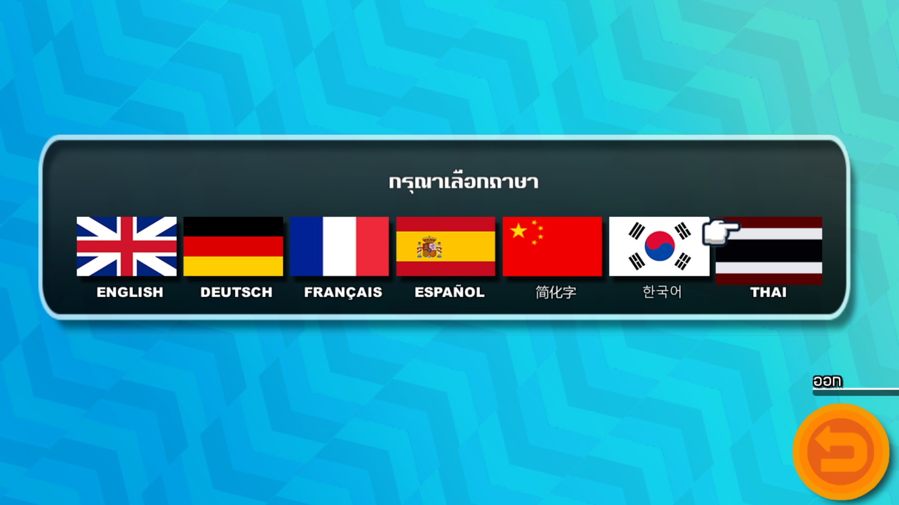

## ดาวน์โหลด

**ดาวน์โหลดมอดภาษาไทย v1.0.0-rc1 ได้จากปุ่มด้านล่างครับ** — เผยแพร่เป็น Pre-release (Release Candidate)

<p align="center">
  <a href="https://github.com/IsAmArt/NEXOMON-MOD-THAI/releases/download/v1.0.0-rc1/NexomonThai_v1.0.0-rc1_MOD_ONLY.zip">
    
  </a>
</p>

<p align="center"><a href="https://github.com/IsAmArt/NEXOMON-MOD-THAI/releases/download/v1.0.0-rc1/NexomonThai_v1.0.0-rc1_MOD_ONLY.zip">ดาวน์โหลด Nexomon ภาษาไทย v1.0.0-rc1 — ZIP โดยตรง</a></p>

<!-- Direct ZIP download verified against the published v1.0.0-rc1 asset. -->

<p align="center">
  <a href="https://github.com/BepInEx/BepInEx/releases/download/v5.4.23.5/BepInEx_win_x64_5.4.23.5.zip">
    
  </a>
</p>

<p align="center"><a href="https://github.com/BepInEx/BepInEx/releases/download/v5.4.23.5/BepInEx_win_x64_5.4.23.5.zip">ดาวน์โหลด BepInEx 5.4.23.5 x64 — ไฟล์ ZIP ทางการ</a></p>

**BepInEx สำหรับ Windows x64 จำเป็นต้องติดตั้งก่อนใช้มอด** และไม่ได้รวมอยู่ใน ZIP มอดภาษาไทยครับ

ชื่อแพ็กเกจที่เตรียมไว้: `NexomonThai_v1.0.0-rc1_MOD_ONLY.zip`

SHA-256 ของไฟล์ที่เตรียมไว้:
```text
68D2A0BE60C2EBCE577B50FC268FD63D1CEA58A2899283BF13CFD9EEBB8F879C
```

## สถานะเวอร์ชัน

**v1.0.0-rc1 — Release Candidate**

ทดลองเล่น **เนื้อเรื่องหลักและเนื้อหาเสริมช่วงท้ายเกม** ด้วยมอดภาษาไทยจนจบแล้ว ไม่พบปัญหาด้านระบบที่ขัดขวางการดำเนินเนื้อเรื่อง

> **หมายเหตุเกี่ยวกับคำแปล**
>
> ตอนนี้สามารถเล่นเนื้อเรื่องหลักและเนื้อหาเสริมช่วงท้ายเกมเป็นภาษาไทยได้จนจบแล้วครับ แต่บางประโยคยังอาจไม่เข้ากับบริบทนัก รวมถึงการตัดคำและการขึ้นบรรทัดใหม่ที่ยังไม่ลงตัวในบางจุด
>
> ผมทำมอดนี้ในเวลาว่าง จึงยังไม่ได้เก็บรายละเอียดครบทุกจุด ตั้งใจจะทยอยกลับมาตรวจแก้ในเวอร์ชันถัดไปเมื่อมีเวลามากพอครับ 
หากพบข้อความที่อ่านแล้วรู้สึกแปลก ๆ สามารถแจ้งไว้ทาง [GitHub Issues](https://github.com/IsAmArt/NEXOMON-MOD-THAI/issues) ได้เลย

รายละเอียดเพิ่มเติมอยู่ใน [ข้อจำกัดที่ทราบ](KNOWN_ISSUES.md)

## สิ่งที่มีในมอด

- คำแปลที่ตรวจแล้ว 713 ไฟล์ข้อความ ครอบคลุมเนื้อเรื่องและส่วนต่าง ๆ ของเกม
- ชื่อทักษะภาษาอังกฤษ พร้อมคำอธิบายภาษาไทย 139 ชุด
- ฟอนต์ TA Regular / Bold และตัวเลือกภาษาไทยที่หน้าเริ่มเกม
- สลับกลับภาษาอังกฤษได้โดยปิดแล้วเปิดเกมใหม่
- เวอร์ชันเผยแพร่ใช้ EXP ตามปกติของเกม โดยไม่ย้อนเลเวลที่เซฟเดิมเคยได้รับจากการทดสอบ
- ติดตั้งผ่าน BepInEx โดยไม่แทนที่ไฟล์ต้นฉบับของเกม

## การติดตั้ง

ใช้กับ Nexomon PC / Steam บน Windows x64 ก่อนอัปเดตมอด ให้ปิดเกมและสำรองมอดกับไฟล์ตั้งค่าเดิมไว้ก่อนครับ ดาวน์โหลดมอดจากปุ่มด้านบนแล้วทำตามขั้นตอนด้านล่าง

1. ดาวน์โหลด **BepInEx 5.4.23.5 x64** จากปุ่มด้านบน แล้วติดตั้งตาม [คู่มือฉบับเต็ม](INSTALLATION.md)
2. ดาวน์โหลด ZIP มอด Nexomon ภาษาไทยจากปุ่มด้านบน
3. แตก ZIP มอด เปิดโฟลเดอร์ `NexomonThai` แล้วคัดลอกโฟลเดอร์ `BepInEx` ภายในไปวางในโฟลเดอร์เกม **ตำแหน่งเดียวกับไฟล์ `Nexomon.exe`** ไม่ใช่ใน `Nexomon_Data`
4. เปิดเกม แล้วเลือก **THAI** จากแถบธงเปลี่ยนภาษาที่หน้าเริ่มเกม

เวอร์ชันเกมที่ตรวจในเครื่องพัฒนา: Steam build **5270054** / Unity **2019.2.8f1** ไม่ต้องติดตั้ง Unity Editor

หากต้องการกลับไปใช้ภาษาอังกฤษ ให้ปิดแล้วเปิดเกมใหม่เพื่อเปลี่ยนภาษาที่หน้าเริ่มเกมครับ

อ่าน [คู่มือติดตั้ง อัปเดต และถอนมอด](INSTALLATION.md) · [ปรับขนาดตัวหนังสือ](THAI_CONFIG_GUIDE.md) · [ประวัติเวอร์ชัน](CHANGELOG.md)

## ภาพตัวอย่าง

### บทสนทนา
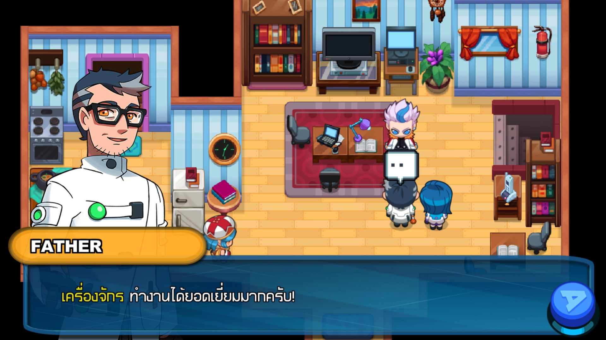

### การต่อสู้
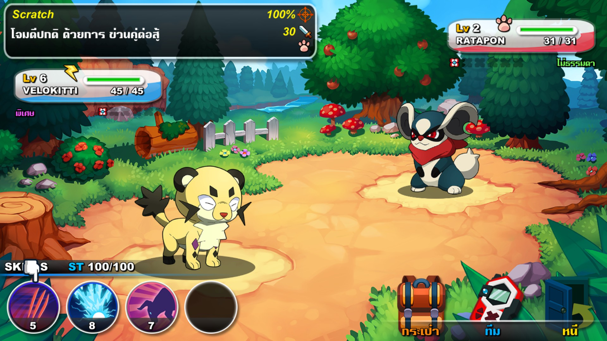

### NexoPad และทักษะ
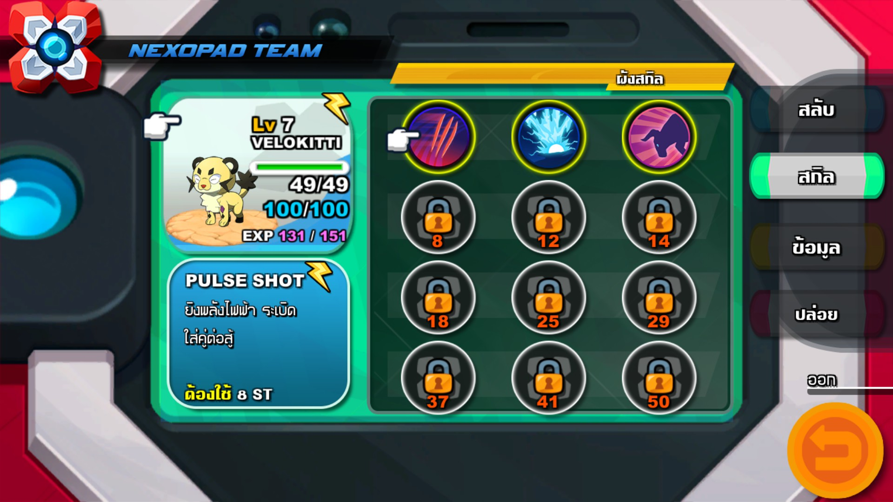

<details>
<summary>ดูภาพตัวอย่างเพิ่มเติม</summary>

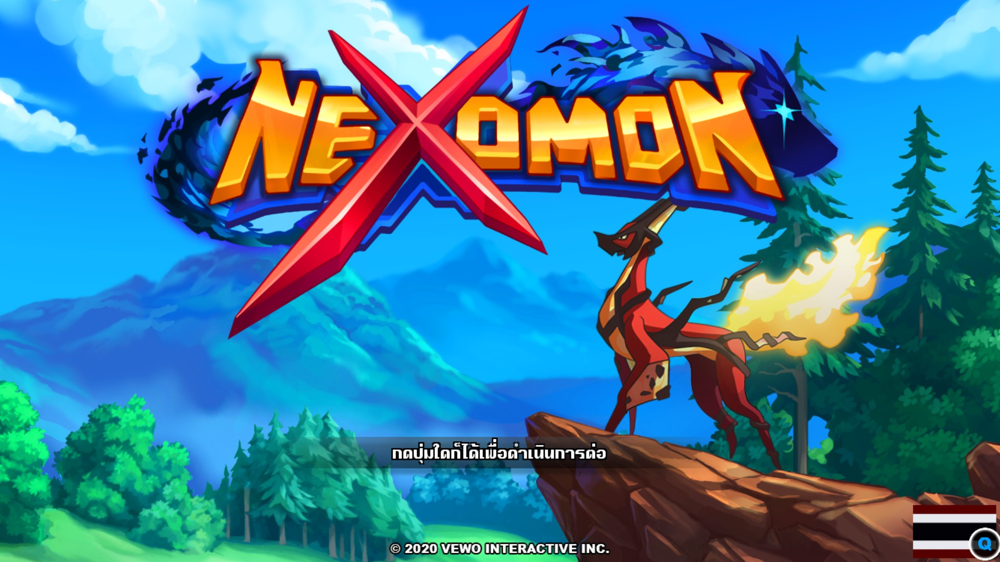

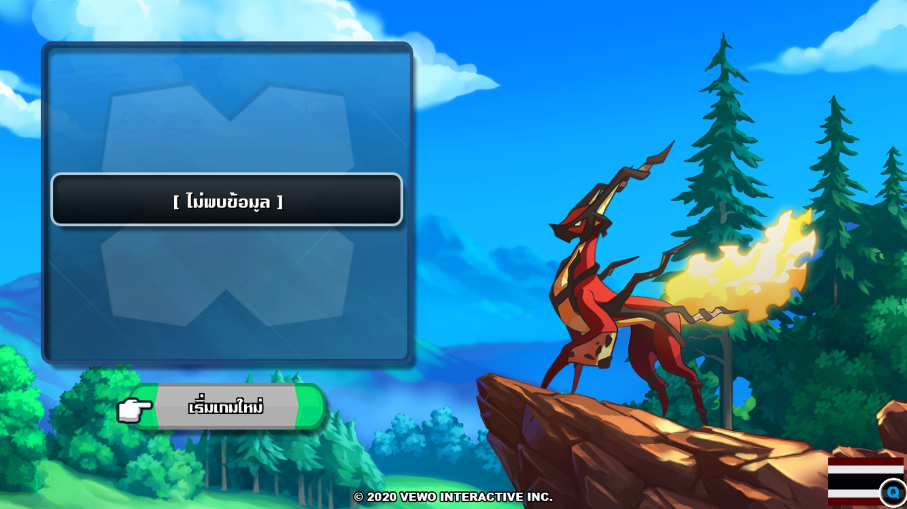


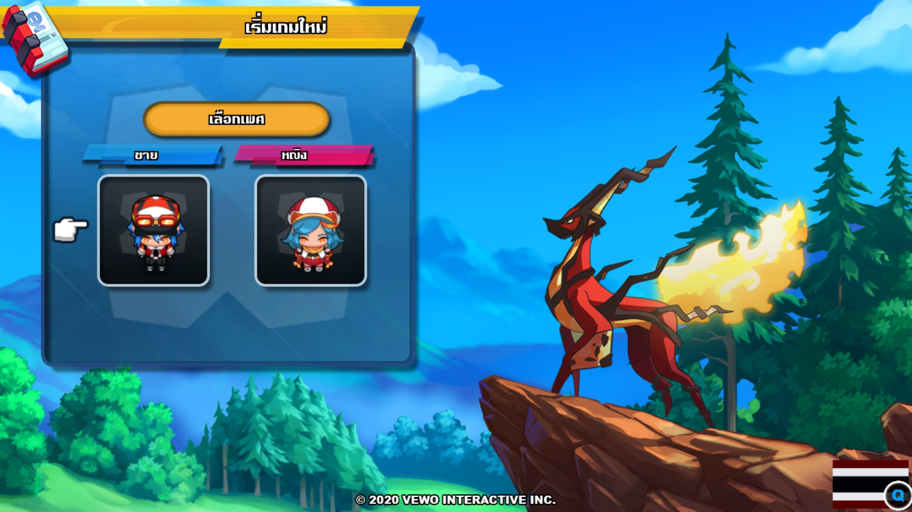

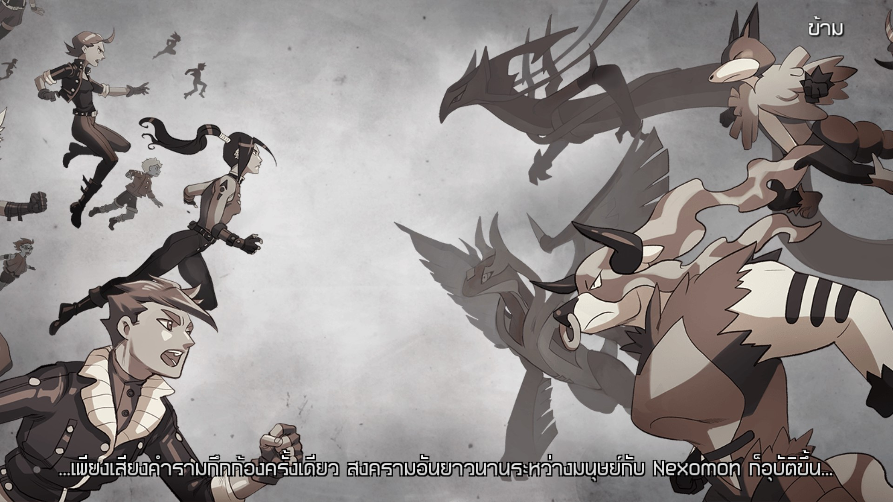

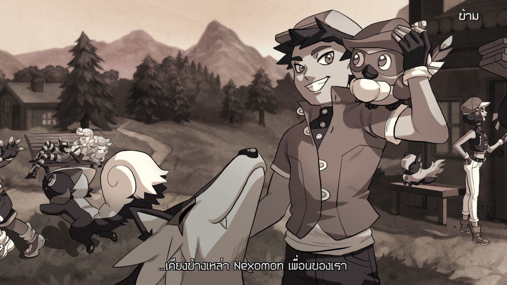

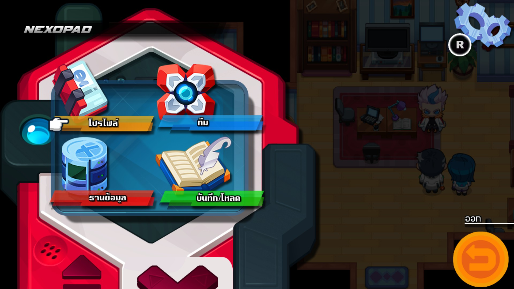

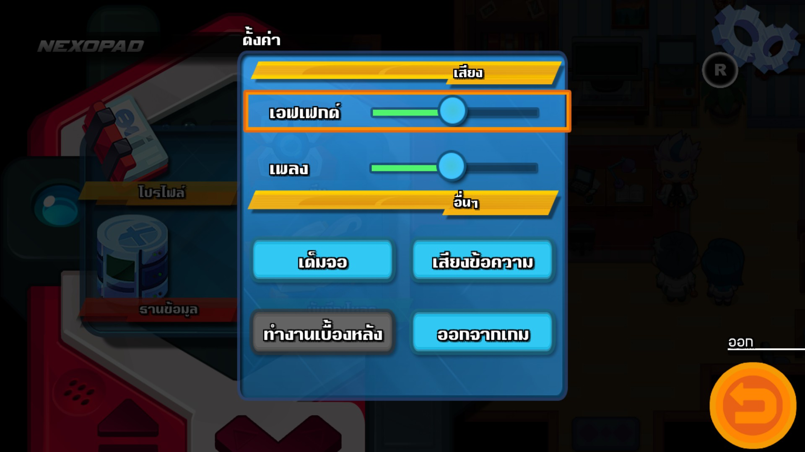


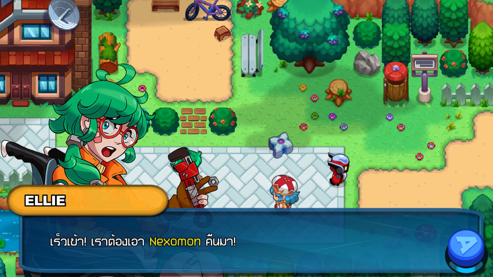


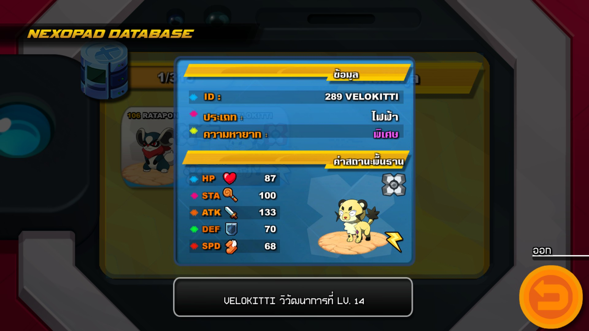

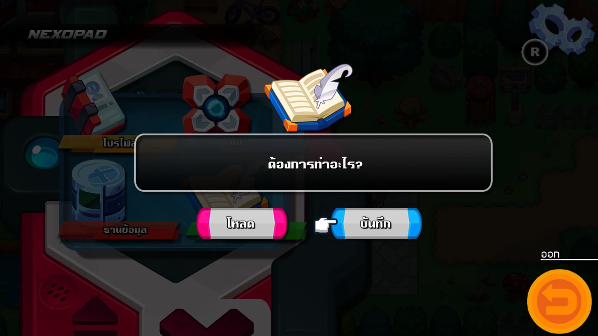

</details>

## แจ้งปัญหา

หากพบคำแปลที่อยากเสนอให้ปรับ หรือมีปัญหาในการใช้งาน แจ้งไว้ทาง [Issues](https://github.com/IsAmArt/NEXOMON-MOD-THAI/issues) ได้ครับ 
ช่วยระบุเวอร์ชันมอด/เกม จุดที่พบ และแนบภาพหน้าจอ หากเป็นปัญหาการทำงานของมอด 
สามารถแนบ `BepInEx/LogOutput.log` เพิ่มได้ โดยปิดบังข้อมูลส่วนตัวก่อนส่ง ไม่จำเป็นต้องโพสต์ไฟล์เซฟสาธารณะครับ

## เครดิตและสิทธิ์

พัฒนามอด ตรวจคำแปล และสร้างฟอนต์ TA โดย **TA Font (IsAmArt)** ใช้ AI/Codex ช่วยในงานพัฒนา ตรวจสอบระบบ และช่วยงานคำแปล/เรียบเรียง ก่อนนำมาตรวจและปรับให้อ่านเข้ากับเกมครับ
ตัวเกมและทรัพย์สินของ Nexomon เป็นของผู้ถือสิทธิ์เดิม มอดนี้เป็นผลงานของผู้เล่นและไม่มีความเกี่ยวข้องอย่างเป็นทางการกับผู้พัฒนาเกม อ่านเพิ่มเติมได้ที่ [เครดิต](CREDITS.md)
ดาวน์โหลดและใช้มอดได้ฟรีเพื่อเล่นเป็นการส่วนตัว หากต้องการแบ่งปันให้ส่งลิงก์ของผู้พัฒนา ไม่อัปโหลดแจกใหม่ ขาย รวมแพ็กเกจ หรือดัดแปลงโดยไม่ได้รับอนุญาต 
ฟอนต์ TA ใช้ได้เฉพาะกับมอดนี้ ไม่อนุญาตให้แยกไปใช้หรือแจกต่ออย่างอิสระ อ่าน [เงื่อนไขการใช้งานไทย/อังกฤษ](LICENSE_DECISION_PENDING.md)

## สนับสนุนการพัฒนาผลงาน

หากชอบผลงานและอยากช่วยสนับสนุนการทำมอดภาษาไทยต่อไป สามารถใช้ QR ด้านล่างได้ครับ การสนับสนุนเป็นความสมัครใจ ขอบคุณทุกคนที่ติดตาม ทดลองเล่น และช่วยแจ้งปัญหาครับ

<p align="center">
  
</p>
